<p align="center">
  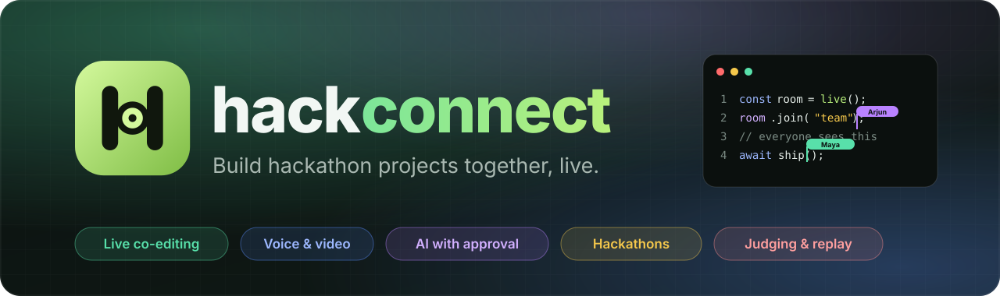
</p>

<p align="center">
  <a href="https://hackconnect-azure.vercel.app"></a>
</p>

<p align="center">
  
  
  
  
  
  
  
  
</p>

<p align="center"><b>Google Docs + VS Code Live Share + Discord + Devpost, for hackathons.</b><br>
Teams edit the same files live, talk in voice and video, bring their own AI with an approval gate, and organizers run the whole event: registration, team workspaces, a live dashboard, a deadline freeze and judging with a replayable build history.</p>

<p align="center">
  <b>Try it: <a href="https://hackconnect-azure.vercel.app">hackconnect-azure.vercel.app</a></b> · backend health: <a href="https://hackconnect-production.up.railway.app/health">hackconnect-production.up.railway.app/health</a>
</p>

> **Built for the Nexconn Build Challenge 2026**, track *Workplace & Collaboration* (direct messaging for teams, project discussion threads, shift handover channel). The team hub runs on the [Nexconn Chat SDK](https://docs.nexconn.ai/chatsdk-web): see [Team hub on Nexconn](#team-hub-on-nexconn).

---

## Contents
[Screenshots](#screenshots) · [What you can do](#what-you-can-do) · [Team hub on Nexconn](#team-hub-on-nexconn) · [How it works](#how-it-works) · [Quick start](#quick-start) · [Deploy](#deploy-frontend-on-vercel-backend-on-railway) · [Configuration](#configuration) · [Develop and test](#develop-and-test) · [Docs](#documentation) · [Project layout](#project-layout)

---

## Screenshots

<p align="center">
  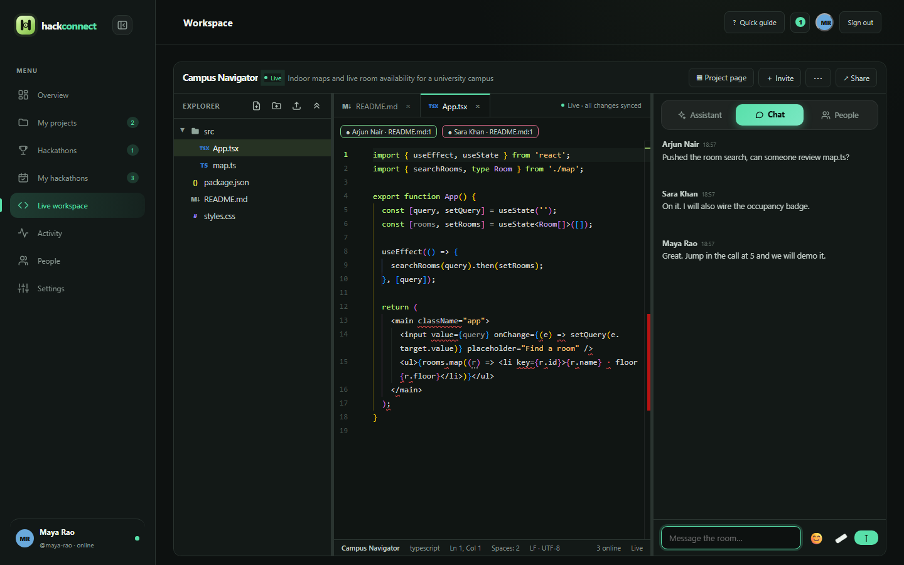
  <br><sub><b>Live workspace</b>: explorer, Monaco editor with live teammate cursors, team chat and assistant on the right.</sub>
</p>

<p align="center">
  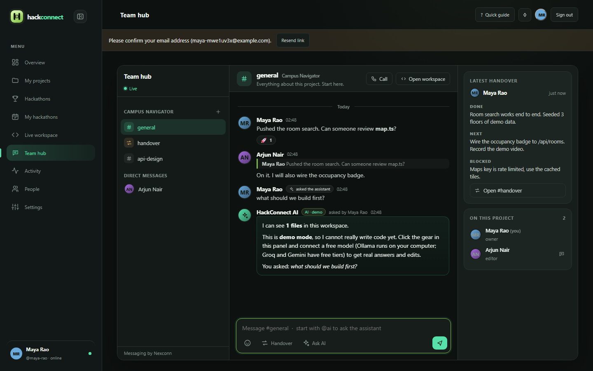
  <br><sub><b>Team hub</b>: project channels and threads on the left, the shared assistant answering in <code>#general</code>, the latest handover and the team on the right.</sub>
</p>

<table>
  <tr>
    <td width="50%">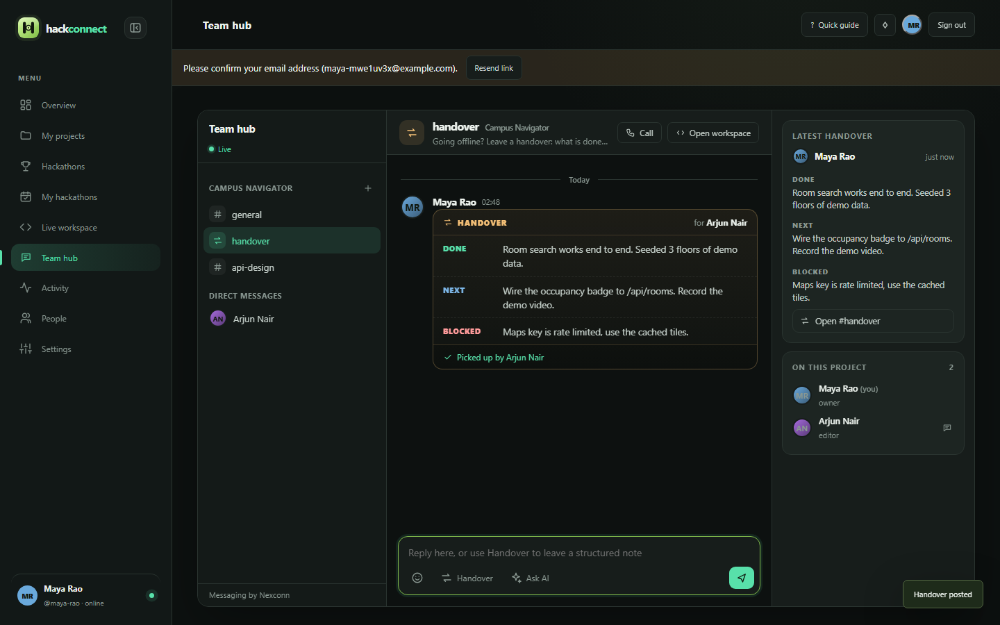<br><sub><b>Shift handover</b>: done / next / blocked, addressed to a teammate, picked up in one click.</sub></td>
    <td width="50%">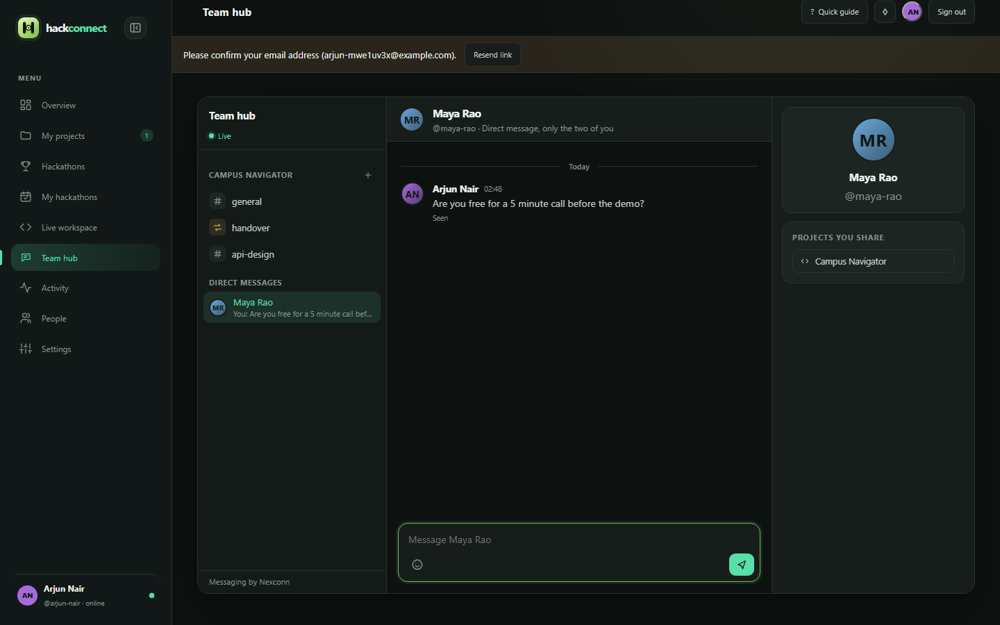<br><sub><b>Direct messages</b>: private, with a typing indicator and "Seen".</sub></td>
  </tr>
  <tr>
    <td width="50%">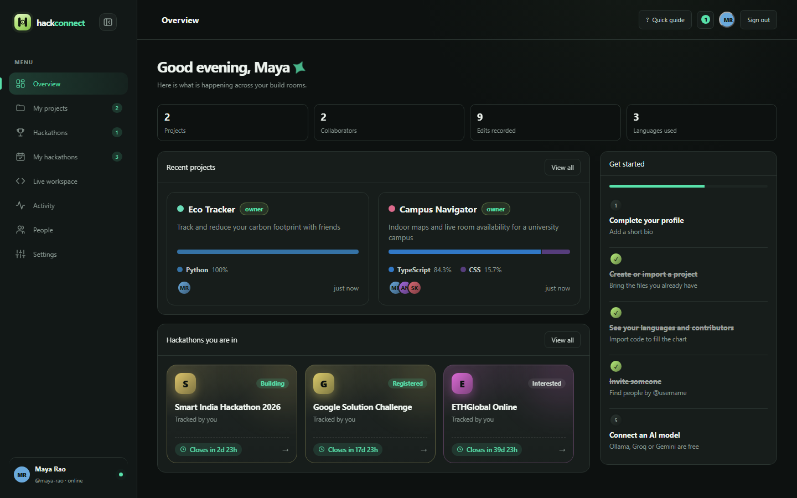<br><sub><b>Overview</b>: your projects with language bars and contributors, plus the hackathons you take part in.</sub></td>
    <td width="50%">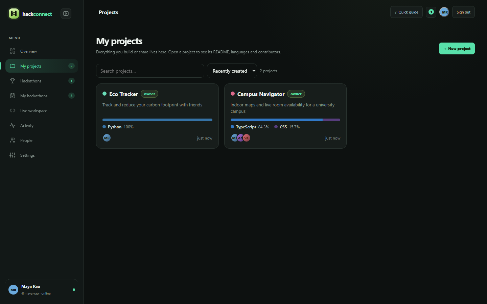<br><sub><b>My projects</b>: search, sort, open a project page or the live workspace.</sub></td>
  </tr>
  <tr>
    <td width="50%">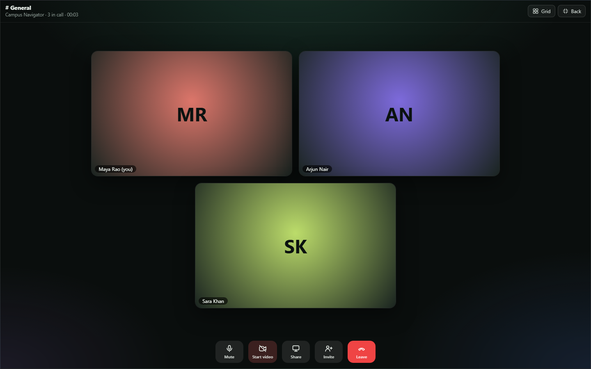<br><sub><b>Voice and video calls</b>: box-sized tiles, speaker highlight, screen share, pin, invite.</sub></td>
    <td width="50%">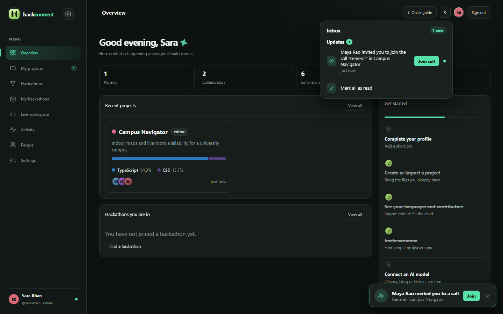<br><sub><b>Call invites</b>: teammates get an inbox message and a live prompt with a one-click <i>Join call</i>.</sub></td>
  </tr>
  <tr>
    <td width="50%">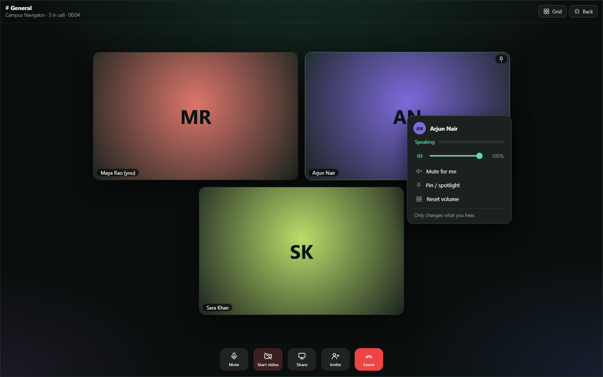<br><sub><b>Per-person volume</b>: right-click anyone for a live speaking meter, volume, mute-for-me and pin.</sub></td>
    <td width="50%">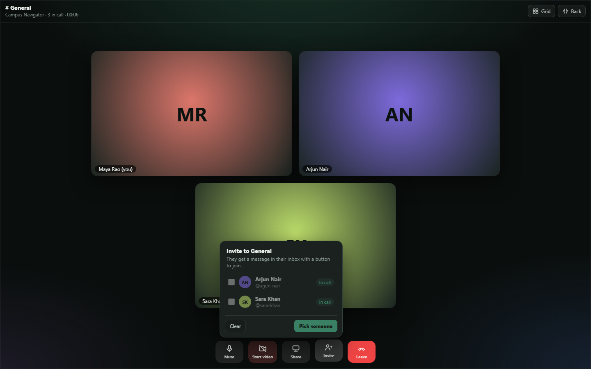<br><sub><b>Invite to the call</b>: pick who to ring, in one click.</sub></td>
  </tr>
  <tr>
    <td width="50%">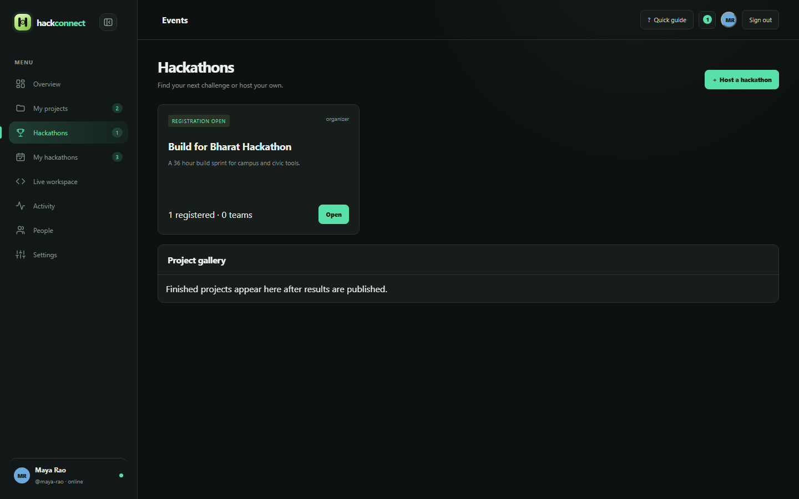<br><sub><b>Hackathons</b>: host or join events with phases, teams and judging.</sub></td>
    <td width="50%">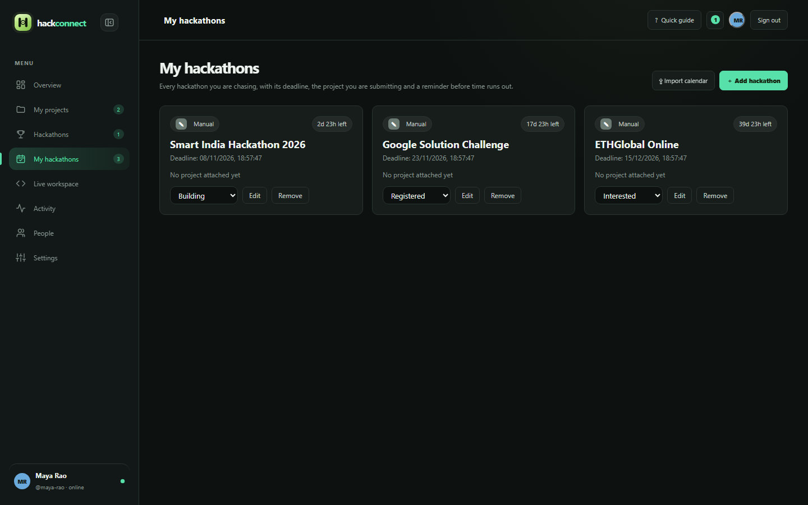<br><sub><b>My hackathons</b>: track any hackathon, with staged deadline reminders in your inbox.</sub></td>
  </tr>
</table>

<details>
<summary><b>More screens</b> (sign in, call panel, menus, phone)</summary>
<br>
<table>
  <tr>
    <td width="33%">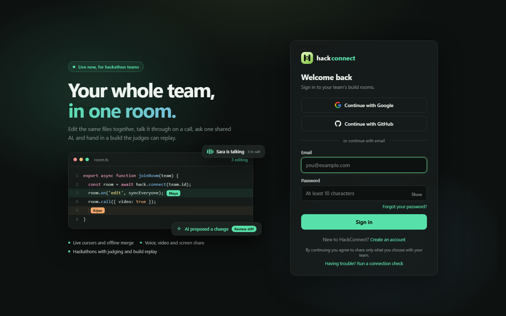<br><sub>Sign in with email, Google or GitHub</sub></td>
    <td width="33%">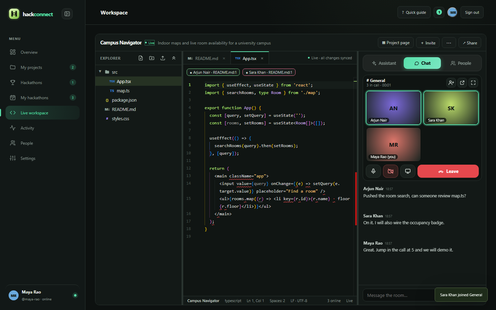<br><sub>A call docked beside your code</sub></td>
    <td width="33%">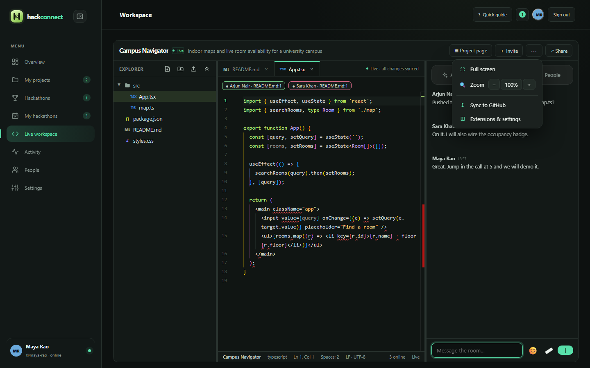<br><sub>Share (view or edit link) and the ⋯ menu</sub></td>
  </tr>
  <tr>
    <td width="33%">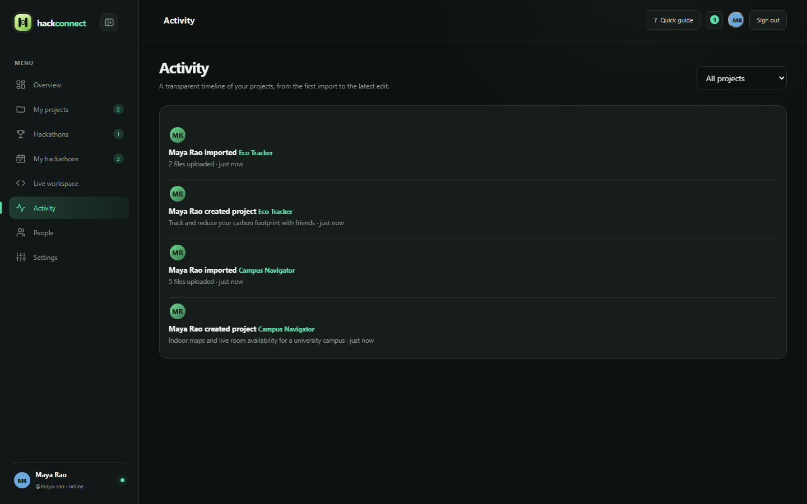<br><sub>Activity timeline</sub></td>
    <td width="33%">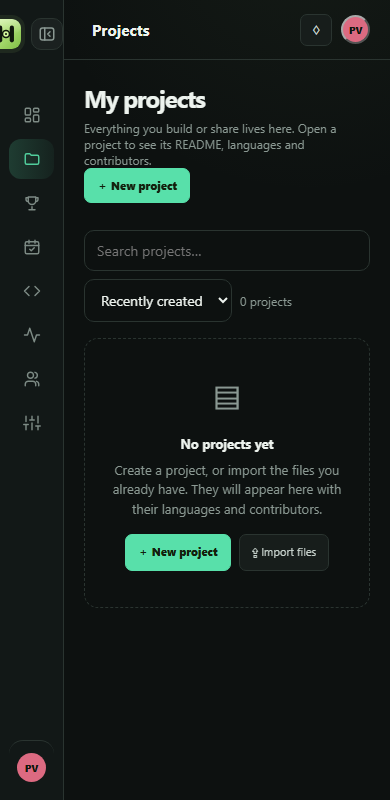<br><sub>Works on a phone</sub></td>
  </tr>
</table>
</details>

> The screenshots are generated from the real app by `node scripts/readme-shots.mjs`, using a throwaway instance, so none of your own data is ever captured.

---

## What you can do

| | |
|---|---|
| **Projects like on GitHub** | Import files, a folder, a zip or a GitHub repository. See the rendered README, a language chart, contributors with avatars, and browse every file. |
| **Live workspace** | Monaco editor on a Yjs CRDT: live remote cursors, presence, follow mode, offline edits merge on reconnect, viewers are read-only. Explorer, tabs, status bar, resizable panels, command palette. |
| **Teams and access** | Unique `@usernames`, connection requests, invite by username or by a **view / edit link**, change a teammate's role or remove them any time, audit log, quotas. |
| **Team hub (Nexconn)** | Every project gets a **#general** channel, a **#handover** channel and as many **discussion threads** as it needs, plus **direct messages** between teammates. Reactions, quoted replies, unread badges, typing and "Seen" in DMs. Leave a structured **shift handover** (done / next / blocked) before you sleep and a teammate picks it up in one click. Type `@ai` and the **shared assistant** answers in the channel, so the whole team sees the same prompt and the same answer. Runs on the [Nexconn](https://nexconn.ai) Chat SDK. |
| **Voice and video** | Several voice channels per project. Voice-only joins stay quiet in a side dock; video can pop out into a floating window or go full screen. Screen share, pin, per-person volume, and **"come join the call" invites** that land in the inbox with a Join button. |
| **AI assistant (bring your own)** | Sign in with **Claude Code or Codex** through a tiny local launcher (your own subscription, no API key), or use Ollama, Groq, Gemini, OpenRouter, OpenAI or Claude with a key stored encrypted. Every change shows a diff and **waits for your approval** (or auto-applies if you choose). |
| **Inbox and reminders** | One dropdown for requests, call invites and updates. Hackathon deadlines notify you at staged intervals before they close. |
| **Overview** | Your recent projects with language bars and contributors, plus a row of cards for the hackathons you take part in (status, source and a live deadline countdown). The "Get started" checklist disappears once every step is done. |
| **Hackathons** | Phases, registration, teams with auto-provisioned workspaces, live organizer dashboard, announcements, mentor requests, deadline freeze with a final snapshot. |
| **Judging** | Submissions with an AI-usage declaration, **Build Replay** (scrub or play 1x to 16x), rubric scoring, blind mode, assignments, conflict-of-interest block, leaderboard, CSV/JSON export, PDF certificates. |
| **Local Bridge CLI** | `hackconnect login \| share \| expose \| workspaces`: two-way folder sync with consent, secret scanner, free `cloudflared` tunnels to share a running app. |
| **Ops** | `/health`, `/ready`, `/metrics`, JSON logs, automatic backups, CI, load test. |

Honest limits (single instance, JSON file storage, no PTY terminal): [docs/KNOWN_ISSUES.md](docs/KNOWN_ISSUES.md).

---

## Team hub on Nexconn

A hackathon team works in shifts across 36 hours: someone is always asleep. The team hub keeps the conversation in one place so nobody has to be woken up to find out where things stand.

| Challenge requirement | In HackConnect | Nexconn feature used |
|---|---|---|
| **Direct messaging for teams** | Private messages between teammates, with a typing indicator, unread badges and "Seen". | Direct channels, typing status, read receipts, unread counts |
| **Project discussion threads** | Every project has `#general`; anyone can start a named thread for one topic (for example `api-design`) so decisions are easy to find. Reactions and quoted replies. | Group channels, message history, message metadata |
| **Shift handover channel** | Every project has `#handover`. A short form posts a **Done / Next / Blocked** card addressed to a teammate or the whole team; "I've got it" marks it picked up. The latest handover is pinned beside every channel. | Custom message type `HC:Handover`, message metadata |
| *Extra:* **shared assistant** | Type `@ai` in a channel: the question and the answer are both in the channel, so the whole team works from the same prompt. | Server-sent group message from a bot user |

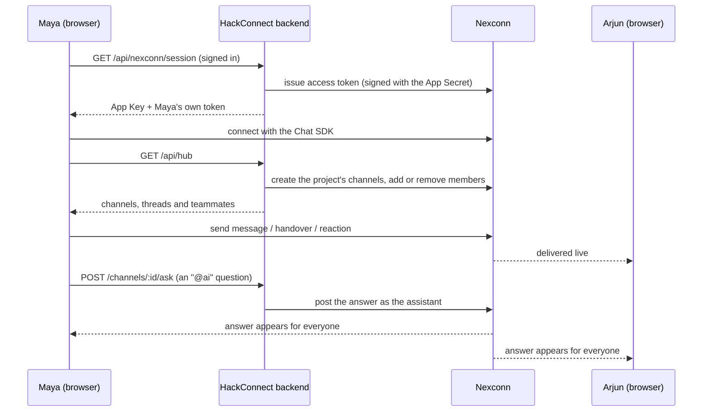

- The **App Secret never reaches the browser**. The backend signs every Platform API call and hands each signed-in person only their own token.
- **Channel membership follows project membership**: invite someone to a project and they are in its channels; remove them and they are out.
- Without `NEXCONN_KEY` / `NEXCONN_SECRET` the rest of the app works as before and the hub says it is not switched on.
- Code: [`lib/nexconn.mjs`](lib/nexconn.mjs) (server), [`hub-ui.js`](hub-ui.js) (interface), [`e2e/hub.e2e.mjs`](e2e/hub.e2e.mjs) (two real browsers against the real service).

Not included: voice and video still use the built-in WebRTC calls, not the Nexconn Call SDK.

---

## How it works

### Architecture (frontend on Vercel, backend on Railway)
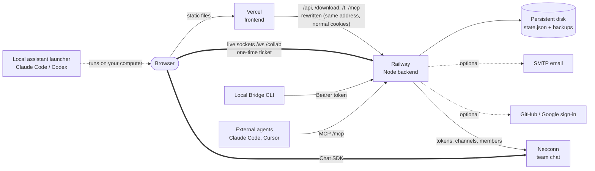
Vercel cannot carry WebSockets and browsers refuse cross-site cookies, so ordinary requests go through Vercel's rewrites (same address, normal login cookie) and only the live sockets connect straight to Railway, signed in by a **60-second single-use ticket** (`POST /api/ws-ticket`). Prefer one address? Deploy only the backend: it serves the UI itself.

### From sign-up to shipping
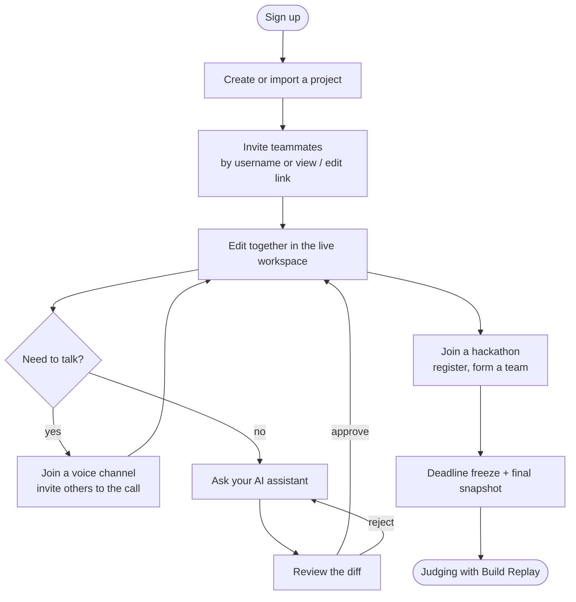

### Live editing
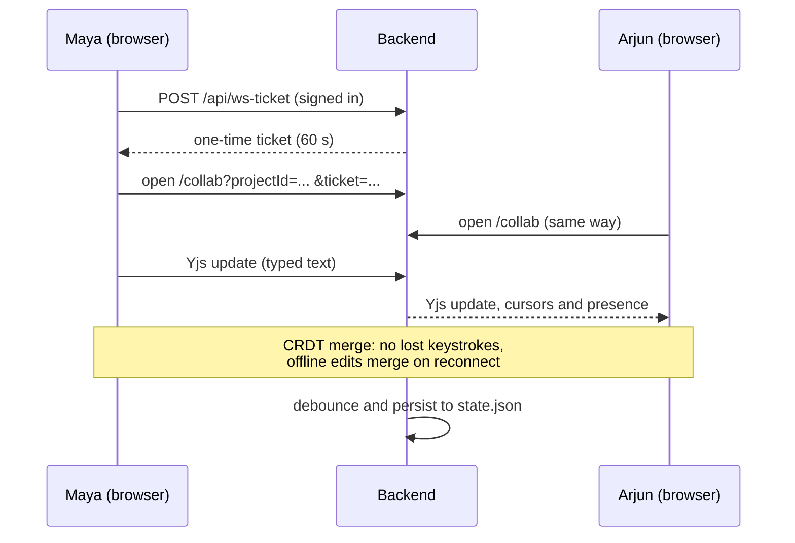

### "Come join the call" invites
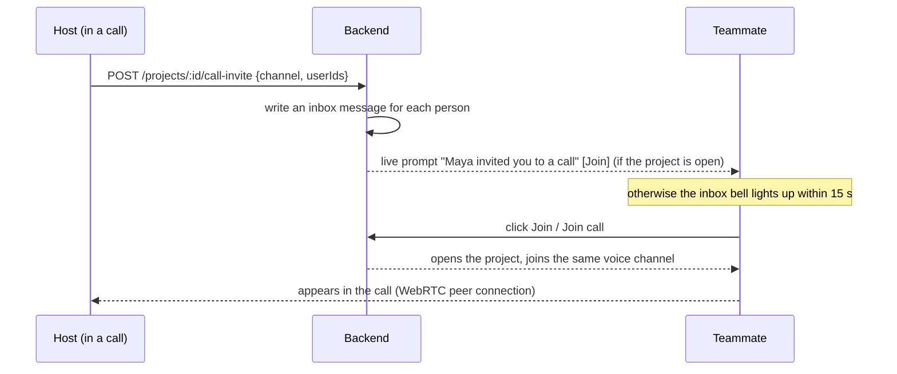

### AI assistant with your own account
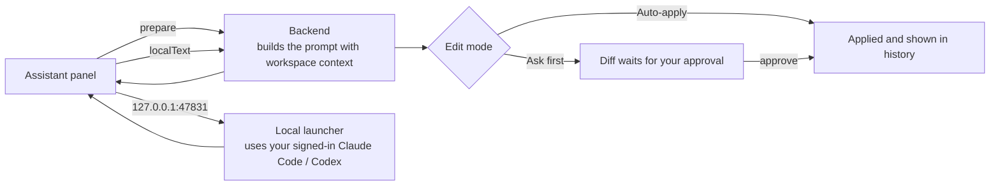
No API key ever reaches the server for Claude/Codex sign-in: the launcher runs on your own computer and the browser talks to it directly.

### Hackathon lifecycle
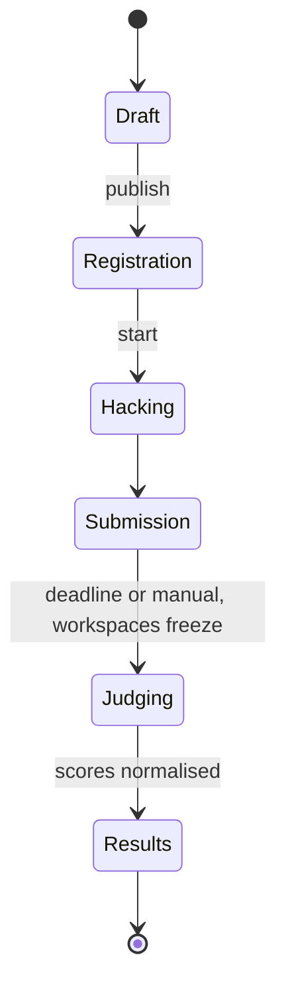

---

## Quick start
```bash
git clone https://github.com/Piyush5525/Hackconnect.git
cd Hackconnect
npm install          # also builds the editor bundle (Yjs + Monaco)
npm start            # open http://localhost:4173 and create an account
```
The first account you create becomes the platform admin. Docker: `docker compose up --build`.

## Deploy: frontend on Vercel, backend on Railway
1. **Railway** (backend): *New Project → Deploy from GitHub repo*. It builds the [`Dockerfile`](Dockerfile) and reads [`railway.json`](railway.json) (one replica, health check `/health`). Then add a **Volume** mounted at `/app/.hackconnect` (the data lives there) and under *Settings → Networking* click **Generate Domain**.
2. **Vercel** (frontend): put your Railway address into every rewrite in [`vercel.json`](vercel.json), push, then *Add New → Project* and import the repo (preset **Other**; the build command and output folder are already set).
3. **Connect them** (Railway → Variables): `HACKCONNECT_BASE_URL` = your Vercel address, `HACKCONNECT_API_URL` = your Railway address, plus the other variables in [docs/DEPLOY.md](docs/DEPLOY.md). Redeploy.
4. **Team hub**: add `NEXCONN_KEY` and `NEXCONN_SECRET` (from the Nexconn console) to the Railway variables.
5. Open the **Vercel** address and sign up first: that account is the admin.

This repository's own deployment: frontend [hackconnect-azure.vercel.app](https://hackconnect-azure.vercel.app), backend `hackconnect-production.up.railway.app`.

Render also works (see [`render.yaml`](render.yaml)). Full walkthrough, backups and troubleshooting: [docs/DEPLOY.md](docs/DEPLOY.md). Check a deployment locally with `npm run e2e:split`.

## Configuration
Copy `.env.example` to `.env`. The important ones:

| Variable | Purpose |
|---|---|
| `HACKCONNECT_BASE_URL` | The public address people open (links in emails, sign-in callbacks, who may open live sockets). |
| `HACKCONNECT_API_URL` | The backend's own address (CLI bridge and VS Code extension downloads). |
| `HACKCONNECT_MASTER_KEY` | Encrypts stored GitHub tokens. Generate once, never change. |
| `SMTP_*` | Real confirmation and password-reset emails. |
| `GITHUB_CLIENT_ID/SECRET`, `GOOGLE_CLIENT_ID/SECRET` | "Continue with GitHub / Google". |
| `HACKCONNECT_TRUST_PROXY` | `true` behind Vercel / Railway so rate limits use the visitor's address. |
| `NEXCONN_KEY`, `NEXCONN_SECRET` | Switch on the team hub (channels, threads, handover, direct messages). The secret stays on the server; each person gets their own token. |
| `HACKCONNECT_AGENT_PROVIDER` | Server-wide assistant: `demo`, `groq`, `gemini`, `openrouter`, `openai`, `anthropic` or `compatible`. `groq` / `gemini` / `openrouter` read `GROQ_API`, `GEMINI_API`, `OPENROUTER_API`. |

Every variable: [docs/ENVIRONMENT.md](docs/ENVIRONMENT.md). Run `npm run check:secrets` before every commit.

## Develop and test
```bash
npm test                 # unit + integration (policy matrix, API, collab convergence, events, bridge, MCP, CLI)
npm run e2e              # two real browsers edit one file and converge
npm run e2e:projects     # projects, people, inbox, member management
npm run e2e:call-invite  # call invites reach the inbox and one click joins the call
npm run e2e:call-volume  # per-person volume + screen share keeps the grid
npm run e2e:signin       # connect Claude / Codex, edit modes, past chats
npm run e2e:split        # the Vercel + Railway setup: proxy + ticketed sockets
npm run e2e:hub          # team hub against the real Nexconn service (skipped without NEXCONN_KEY / NEXCONN_SECRET)
npm run build:client     # rebuild vendor/ (Yjs + Monaco + Nexconn Chat SDK) after editing src/
node scripts/readme-shots.mjs   # regenerate the screenshots above
```

## Documentation
[Architecture](docs/ARCHITECTURE.md) · [Deploy](docs/DEPLOY.md) · [Environment](docs/ENVIRONMENT.md) · [API](docs/API.md) · [Security](docs/SECURITY.md) · [Runbook](docs/RUNBOOK.md) · [Decisions](docs/DECISIONS.md) · [Known issues](docs/KNOWN_ISSUES.md)

## Project layout
```
index.html, app.js, *-ui.js     the interface (vanilla JS, no build step)
hub-ui.js                       team hub: channels, threads, handover, direct messages (Nexconn Chat SDK)
config.js, net.js               where the backend lives + how live sockets connect
src/                            editor + Nexconn client source, bundled into vendor/
lib/                            backend: app, auth, collab, events, judging, tracker, social, agent, nexconn...
bridge/                         Local Bridge CLI and the assistant launcher
scripts/                        build-frontend (Vercel), build-client, backup, smoke, readme-shots...
railway.json, vercel.json       deployment config (render.yaml as an alternative)
test/, e2e/                     unit and real-browser tests
```

<p align="center"><sub>Built for hackathon teams. Free and open-source tools all the way down.</sub></p>
