<p align="center">
  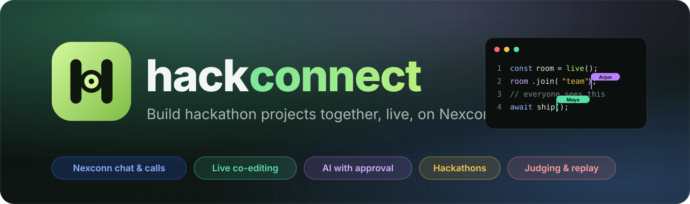
</p>

<p align="center">
  <a href="https://nexconn.ai"></a>
  <a href="https://hackconnect-azure.vercel.app"></a>
  <a href="HackConnect_Nexconn_Demo.mp4"></a>
  <a href="HackConnect_Nexconn_Pitch.pptx?raw=true"></a>
</p>

<p align="center">
  
  
  
  
  <br>
  
  
  
  
  
</p>

<p align="center"><b>A hackathon team's whole conversation, on Nexconn, right next to their code.</b><br>
Every project gets its own Nexconn channels, threads and direct messages. The chat beside the editor is the same Nexconn channel. An AI teammate answers inside it, shift handovers are Nexconn custom messages, and 1:1 and group voice and video calls run on Nexconn Call. Around that: a live co-editing workspace, bring-your-own AI with an approval gate, and the full hackathon toolkit (registration, teams, deadline freeze, judging with build replay).</p>

<p align="center">
  <b>Try it: <a href="https://hackconnect-azure.vercel.app">hackconnect-azure.vercel.app</a></b> · backend health: <a href="https://hackconnect-production.up.railway.app/health">hackconnect-production.up.railway.app/health</a>
</p>

---

## Contents
[Demo video and pitch deck](#demo-video-and-pitch-deck) · [Built on Nexconn](#built-on-nexconn) · [Screenshots](#screenshots) · [What you can do](#what-you-can-do) · [How it works](#how-it-works) · [Quick start](#quick-start) · [Set up Nexconn](#set-up-nexconn) · [Deploy](#deploy-frontend-on-vercel-backend-on-railway) · [Configuration](#configuration) · [Develop and test](#develop-and-test) · [Docs](#documentation) · [Project layout](#project-layout)

---

## Demo video and pitch deck

| | |
|---|---|
| 🎬 **Demo video** | [Watch the HackConnect × Nexconn demo](HackConnect_Nexconn_Demo.mp4) (MP4, ~18 MB, plays in the browser on GitHub) |
| 📊 **Pitch deck** | [Download the pitch deck](HackConnect_Nexconn_Pitch.pptx?raw=true) (PowerPoint, ~2.6 MB) |

---

## Built on Nexconn

<p align="center">
  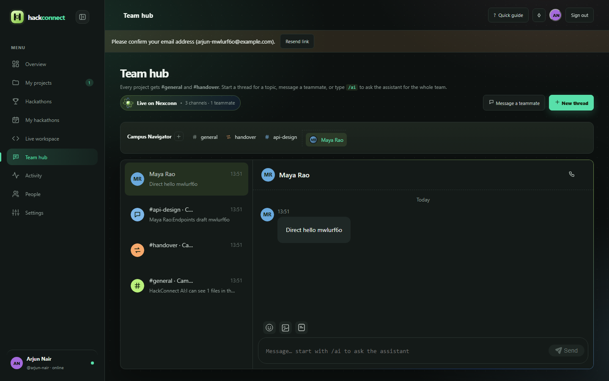
  <br><sub><b>Team hub</b>: project channels, threads and direct messages, rendered by the Nexconn Chat UI SDK.</sub>
</p>

Hackathon teams usually split their day across a code editor, a chat app and a call app, and lose context every time they switch. HackConnect puts all of it in one place, and **Nexconn carries every message and every call**. HackConnect stores no chat history of its own: Nexconn is the source of truth.

### Nexconn products used

| Nexconn product | Package | What HackConnect does with it |
|---|---|---|
| **Chat UI SDK** | `@nexconn/chatui` 26.2.5 | The whole Team hub UI: channel list, conversation view, composer, images, files, emoji, replies, forwarding, read state, typing and unread badges. HackConnect customizes it through the documented hooks (user, group and member profiles), custom messages, channel panel extensions, a language pack and `MESSAGE_WILL_SEND`. |
| **Chat SDK** | `@nexconn/chat` 26.2.1 | Connecting with each person's token, the live chat pane inside the code workspace (history query, sending and receiving messages), the total unread count on the nav badge, and toasts for new messages. |
| **Call SDK** | `@nexconn/call` 26.2.1 | 1:1 and group voice and video calls: start, ring, accept or decline, mute, camera, device choice, inviting more people mid-call and hanging up. |
| **Server API (v4)** | signed REST calls from `lib/nexconn.mjs` | Issuing access tokens, creating, joining, leaving and dismissing group channels as project membership changes, and posting as the HackConnect AI bot or on a person's behalf. |

### What runs on Nexconn

| Feature | How it uses Nexconn |
|---|---|
| **Project channels** | Each project automatically gets **#general** and **#handover** Nexconn group channels. Members are kept in sync with the project: invite someone and they join, remove them and they leave, delete the project and its channels are dismissed. |
| **Threads** | Start a topic thread (for example *#api-bug*) from the hub; it is a new Nexconn group channel with the same members. Archive it when you're done. |
| **Direct messages** | Message any teammate one-to-one in a Nexconn direct channel, with unread badges across the app. |
| **Workspace chat** | The chat panel inside the live code editor *is* the project's Nexconn #general, so the hub and the editor show one conversation. Anything else that posts project chat (stickers, the Local Bridge CLI, the VS Code extension) is posted into Nexconn as that person. |
| **AI teammate** | Type `/ai <question>` in any project channel. HackConnect catches it with the Chat UI's `MESSAGE_WILL_SEND` event, asks the assistant with the project as context, and posts a plain-text reply as the **HackConnect AI** Nexconn user, so the whole team sees it. New members are welcomed by the bot too. |
| **Shift handovers** | A *done / next / blocked* card is a registered Nexconn **custom message** (`HC:Handover`) with its own bubble, posted to #handover so whoever picks up next knows where things stand. |
| **Live connection status** | A *Live on Nexconn* pill in the hub header follows the Chat SDK's connection status (connected, connecting, offline) and shows how many channels and teammates you can reach. |
| **Dark Chat UI** | The Chat UI SDK ships a light palette inside its web components. A small esbuild plugin recolours it while bundling so the hub matches the dark app, and the SDK's own icon hover swaps keep working. |
| **Voice and video calls** | The phone button in a direct message rings that person; in a project channel or the workspace's Call button, it rings the whole team. Calls run entirely on Nexconn Call. |

### How the pieces fit

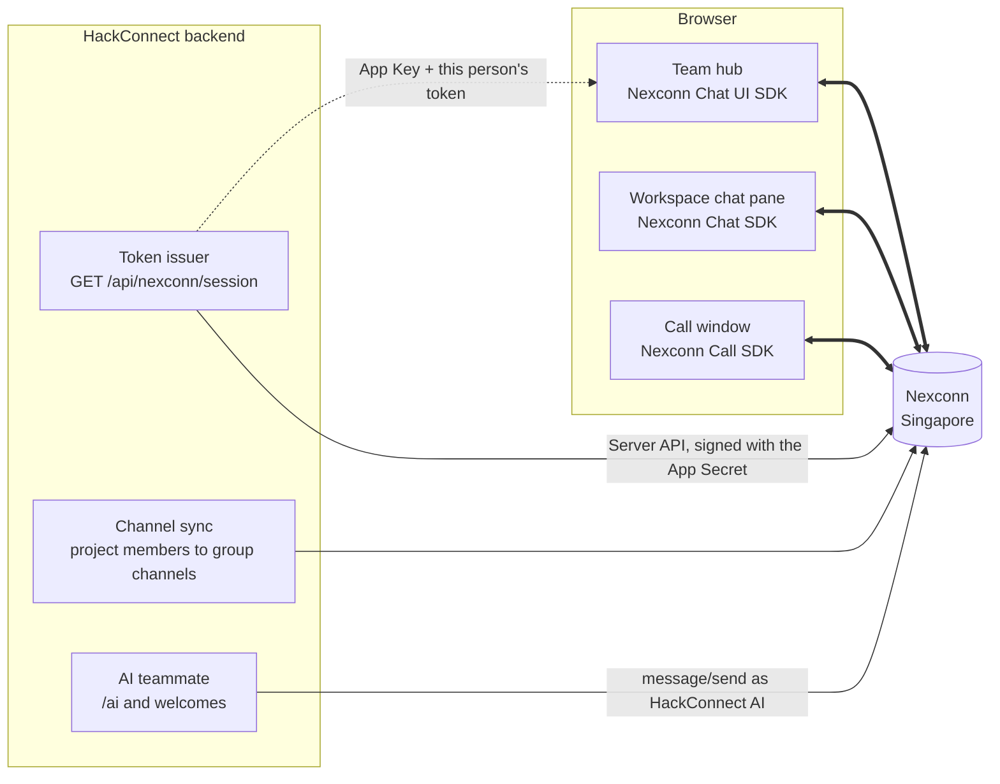

**Security.** The Nexconn App Secret never leaves the server. Every Server API request is signed with it (`SHA1(secret + nonce + timestamp)`), and each signed-in person gets their own Nexconn access token, so the browser only ever sees the public App Key and that person's token.

### Where the Nexconn code lives

| File | What it does |
|---|---|
| [`lib/nexconn.mjs`](lib/nexconn.mjs) | Server side: signed Server API client, token cache, channel creation and membership sync, the AI bot, and the `/api/nexconn/session`, `/api/hub` and channel routes. |
| [`hub-ui.js`](hub-ui.js) | The Team hub: Chat UI setup, profile hooks, the handover custom message, panel extensions (call, AI, handover, open workspace, archive), `/ai`, unread counts and the workspace chat bridge. |
| [`nx-call.js`](nx-call.js) | Calls: Call SDK engine, ringing, the incoming-call prompt, the call window with video tiles, and the controls. |
| [`src/nexconn-client.js`](src/nexconn-client.js) | Bundles the three SDKs into `vendor/nexconn-client.js` (`npm run build:client`). |
| [`scripts/nexconn-dark.mjs`](scripts/nexconn-dark.mjs) | The build-time dark theme for the Chat UI SDK. |
| [`test/nexconn.test.mjs`](test/nexconn.test.mjs), [`e2e/hub.e2e.mjs`](e2e/hub.e2e.mjs) | Unit tests against a fake Nexconn, and a two-browser test against the real Nexconn service. |

---

## Screenshots

<table>
  <tr>
    <td width="50%">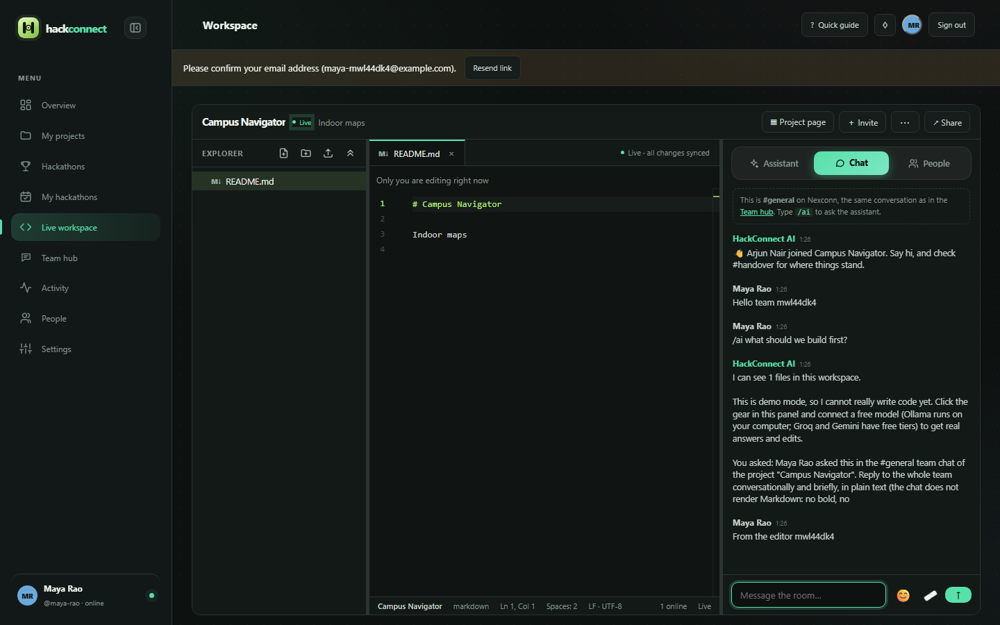<br><sub><b>One conversation</b>: the chat beside the editor is the project's Nexconn #general, with <code>/ai</code> answers for everyone.</sub></td>
    <td width="50%">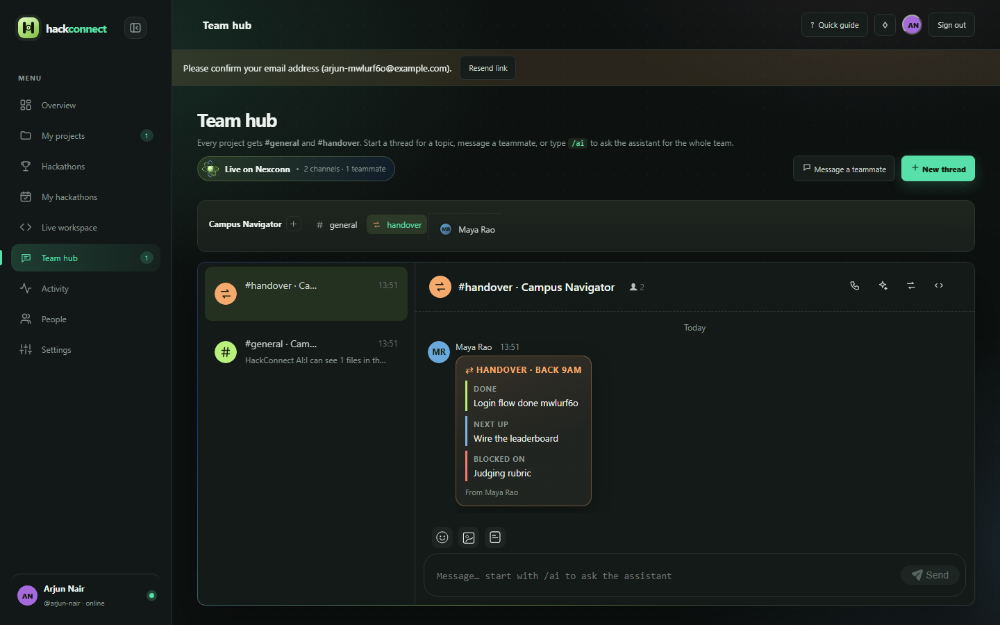<br><sub><b>Shift handover</b>: a done / next / blocked Nexconn custom message in #handover.</sub></td>
  </tr>
</table>

<p align="center">
  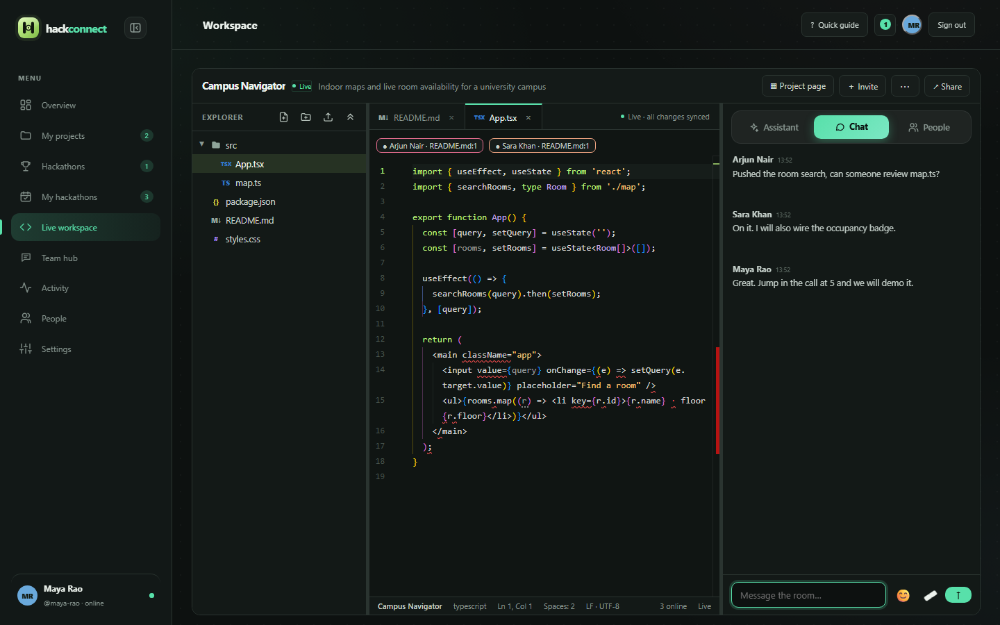
  <br><sub><b>Live workspace</b>: explorer, Monaco editor with live teammate cursors, and the Nexconn team chat on the right.</sub>
</p>

<table>
  <tr>
    <td width="50%">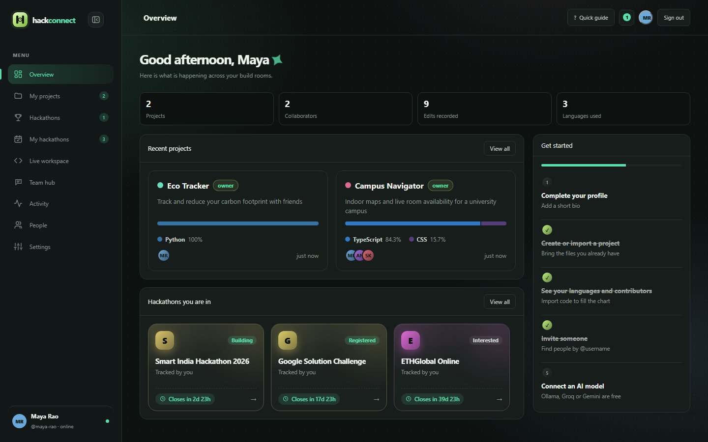<br><sub><b>Overview</b>: your projects with language bars and contributors, plus the hackathons you take part in.</sub></td>
    <td width="50%">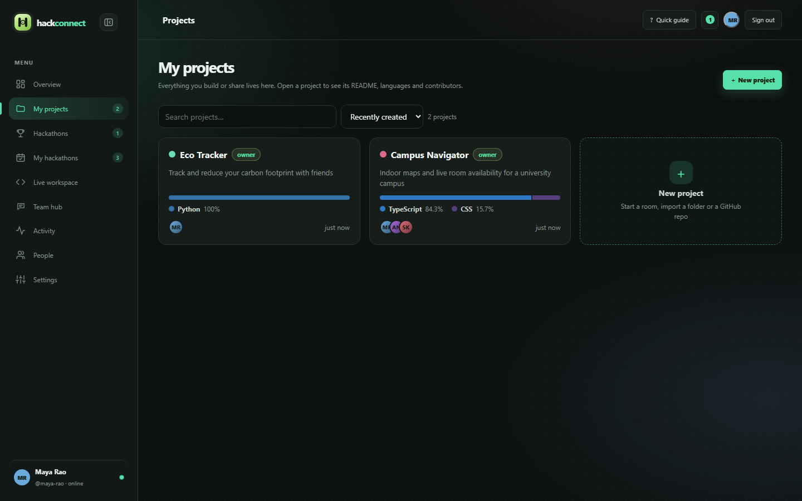<br><sub><b>My projects</b>: search, sort, open a project page or the live workspace.</sub></td>
  </tr>
  <tr>
    <td width="50%">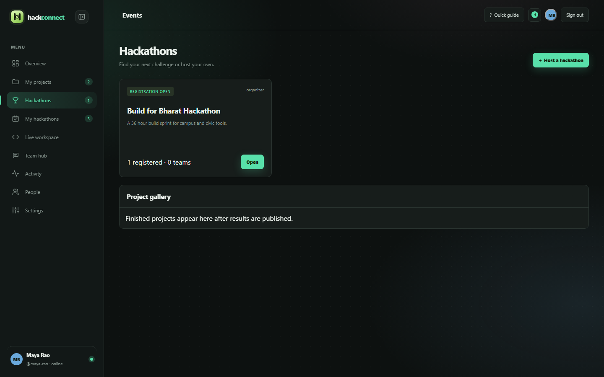<br><sub><b>Hackathons</b>: host or join events with phases, teams and judging.</sub></td>
    <td width="50%">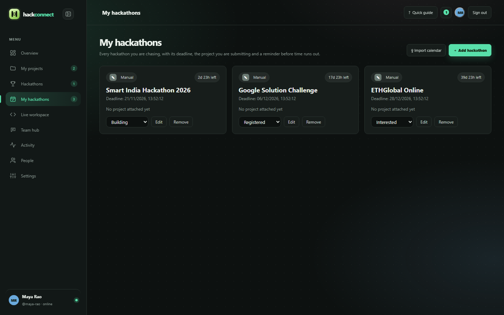<br><sub><b>My hackathons</b>: track any hackathon, with staged deadline reminders in your inbox.</sub></td>
  </tr>
</table>

<details>
<summary><b>More screens</b> (sign in, menus, activity, phone)</summary>
<br>
<table>
  <tr>
    <td width="33%">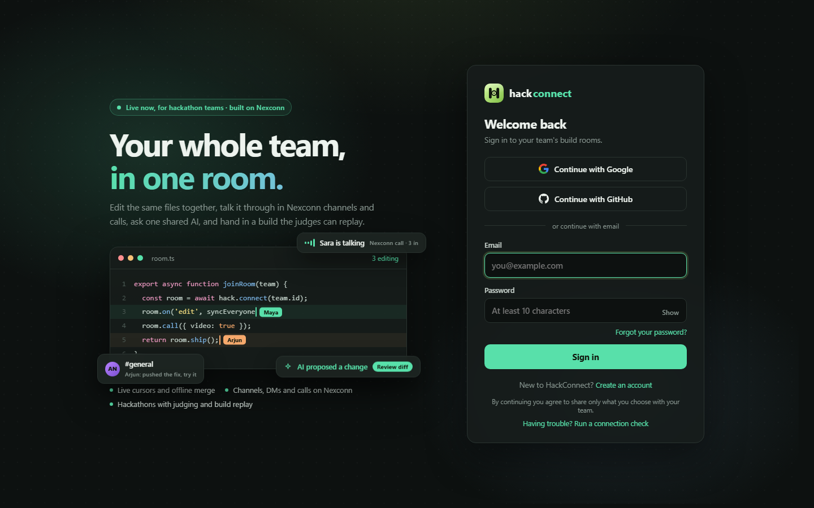<br><sub>Sign in with email, Google or GitHub</sub></td>
    <td width="33%">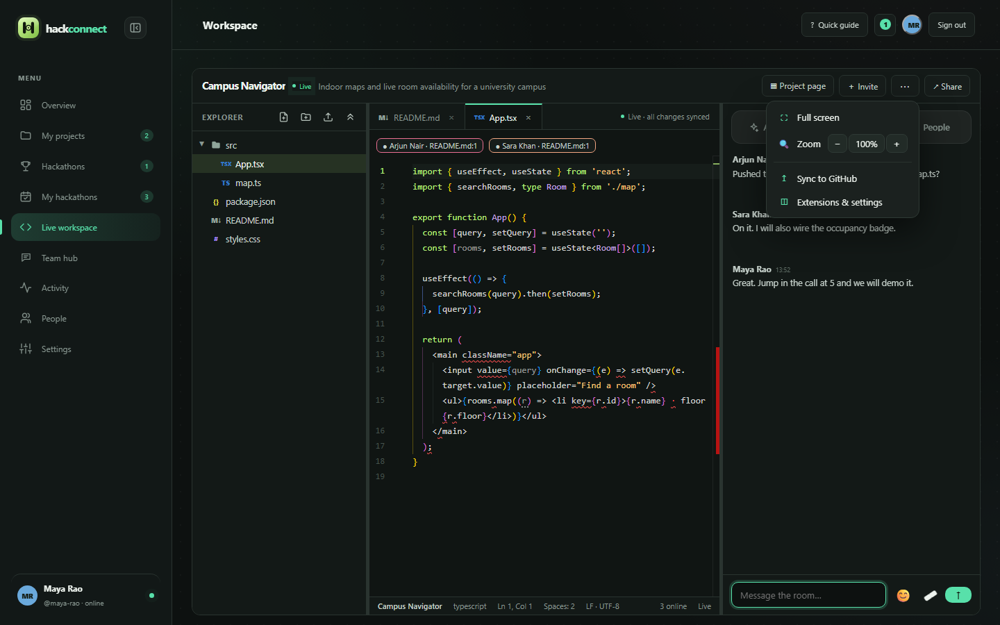<br><sub>Share (view or edit link) and the ⋯ menu</sub></td>
    <td width="33%">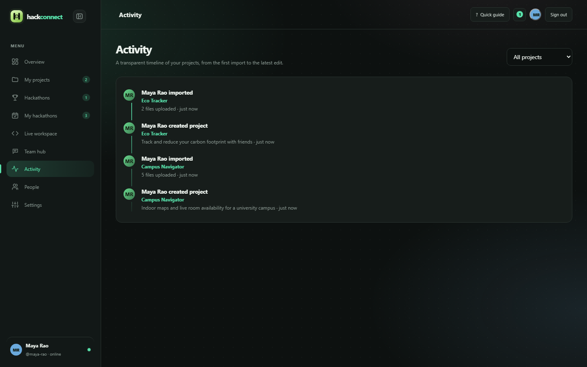<br><sub>Activity timeline</sub></td>
  </tr>
  <tr>
    <td width="33%">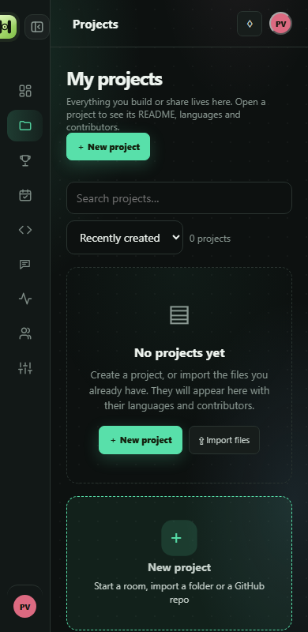<br><sub>Works on a phone</sub></td>
  </tr>
</table>
</details>

> The screenshots are generated from the real app by `node scripts/readme-shots.mjs`, using a throwaway instance, so none of your own data is ever captured.

---

## What you can do

| | |
|---|---|
| **Team hub (Nexconn Chat UI)** | Project **#general** and **#handover** channels, topic **threads** and **direct messages**, with images, files, emoji, replies, forwarding, read state, typing and unread badges. Leave a structured **handover** before you log off. |
| **AI teammate in chat (Nexconn)** | Type `/ai` in any project channel, or in the workspace chat, and the shared assistant answers in the channel for the whole team. |
| **Voice and video (Nexconn Call)** | 1:1 calls from a direct message, group calls from a project channel or the workspace's Call button. Incoming calls ring with Accept / Decline; the call window shows everyone's video (or initials), with mute, camera, device choice, invite more and full screen. |
| **Live workspace** | Monaco editor on a Yjs CRDT: live remote cursors, presence, follow mode, offline edits merge on reconnect, viewers are read-only. The team chat on the right is the project's Nexconn #general. |
| **Projects like on GitHub** | Import files, a folder, a zip or a GitHub repository. See the rendered README, a language chart, contributors with avatars, and browse every file. |
| **Teams and access** | Unique `@usernames`, connection requests, invite by username or by a **view / edit link**, change a teammate's role or remove them any time (their Nexconn channel membership follows), audit log, quotas. |
| **AI assistant (bring your own)** | Sign in with **Claude Code or Codex** through a tiny local launcher (your own subscription, no API key), or use Ollama, Groq, Gemini, OpenRouter, OpenAI or Claude with a key stored encrypted. Every change shows a diff and **waits for your approval** (or auto-applies if you choose). |
| **Hackathons** | Phases, registration, teams with auto-provisioned workspaces (and Nexconn channels), live organizer dashboard, announcements, mentor requests, deadline freeze with a final snapshot. |
| **Judging** | Submissions with an AI-usage declaration, **Build Replay** (scrub or play 1x to 16x), rubric scoring, blind mode, assignments, conflict-of-interest block, leaderboard, CSV/JSON export, PDF certificates. |
| **Inbox and reminders** | One dropdown for requests and updates. Hackathon deadlines notify you at staged intervals before they close. |
| **Local Bridge CLI** | `hackconnect login \| share \| expose \| workspaces`: two-way folder sync with consent, secret scanner, free `cloudflared` tunnels to share a running app. |
| **Ops** | `/health`, `/ready`, `/metrics`, JSON logs, automatic backups, CI, load test. |

Honest limits (single instance, JSON file storage, no PTY terminal): [docs/KNOWN_ISSUES.md](docs/KNOWN_ISSUES.md).

---

## How it works

### Messages and calls on Nexconn
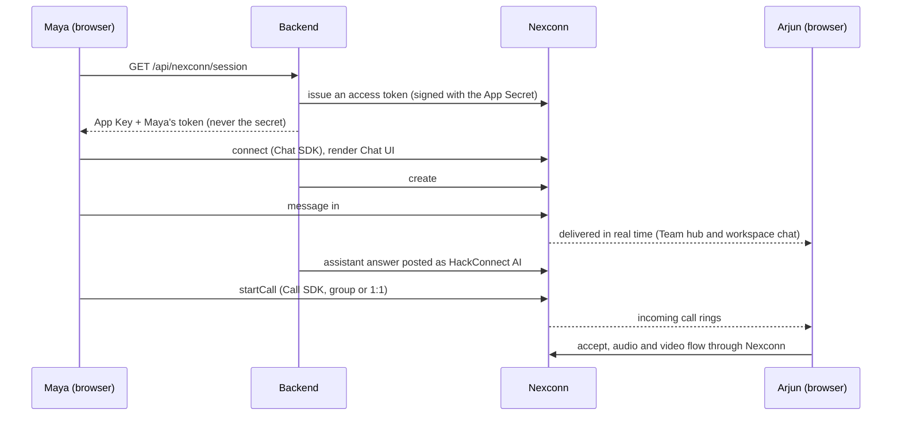

### Architecture (frontend on Vercel, backend on Railway)
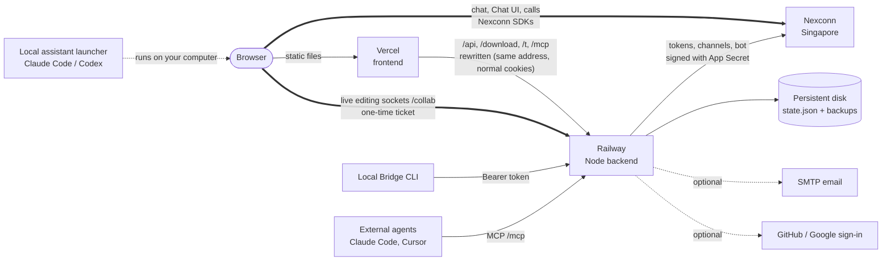
Chat and calls go straight from the browser to Nexconn. Vercel cannot carry WebSockets and browsers refuse cross-site cookies, so ordinary requests go through Vercel's rewrites (same address, normal login cookie) and only the live editing sockets connect straight to Railway, signed in by a **60-second single-use ticket** (`POST /api/ws-ticket`). Prefer one address? Deploy only the backend: it serves the UI itself.

### From sign-up to shipping
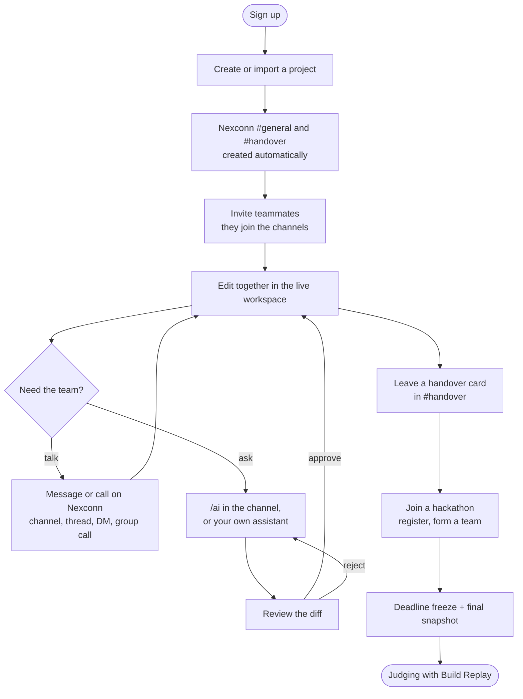

### Live editing
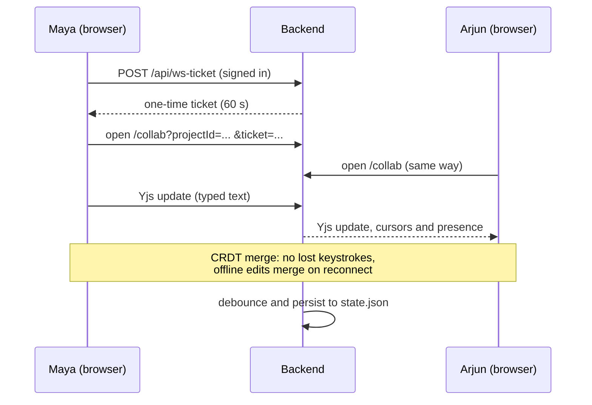

### AI assistant with your own account
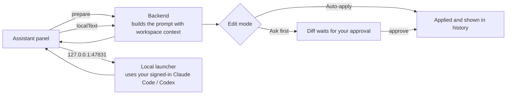
No API key ever reaches the server for Claude/Codex sign-in: the launcher runs on your own computer and the browser talks to it directly.

### Hackathon lifecycle
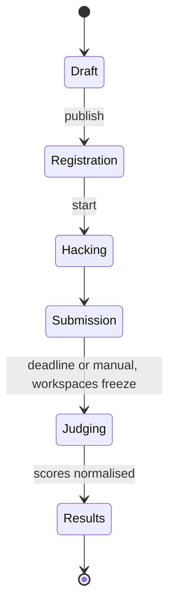

---

## Quick start
```bash
git clone https://github.com/Piyush5525/Hackconnect.git
cd Hackconnect
npm install          # also builds the client bundles (Yjs + Monaco + Nexconn SDKs)
cp .env.example .env # then add NEXCONN_KEY and NEXCONN_SECRET (see below)
npm start            # open http://localhost:4173 and create an account
```
The first account you create becomes the platform admin. Docker: `docker compose up --build`.

## Set up Nexconn
1. Create an app in the [Nexconn console](https://nexconn.ai) and copy its **App Key** and **App Secret**.
2. Put them in `.env` as `NEXCONN_KEY` and `NEXCONN_SECRET` (on Railway: *Variables*). The default data center is Singapore; change `NEXCONN_API_HOST` and `NEXCONN_AREA_CODE` only if your app lives elsewhere.
3. **For calls**, open **Call → Call Subscription** in the console and activate the Call service for the app. Chat works on the free plan; until calling is activated, the call button explains that it is switched off instead of failing silently. Call webhooks are not needed.
4. Restart the server and open **Team hub**. Channels for existing projects are created the first time a member opens the hub.

Without the two keys HackConnect still runs, and the hub says it is switched off.

## Deploy: frontend on Vercel, backend on Railway
1. **Railway** (backend): *New Project → Deploy from GitHub repo*. It builds the [`Dockerfile`](Dockerfile) and reads [`railway.json`](railway.json) (one replica, health check `/health`). Then add a **Volume** mounted at `/app/.hackconnect` (the data lives there) and under *Settings → Networking* click **Generate Domain**.
2. **Vercel** (frontend): put your Railway address into every rewrite in [`vercel.json`](vercel.json), push, then *Add New → Project* and import the repo (preset **Other**; the build command and output folder are already set). The Content Security Policy in `vercel.json` already allows the Nexconn hosts.
3. **Connect them** (Railway → Variables): `NEXCONN_KEY`, `NEXCONN_SECRET`, `HACKCONNECT_BASE_URL` = your Vercel address, `HACKCONNECT_API_URL` = your Railway address, plus the other variables in [docs/DEPLOY.md](docs/DEPLOY.md). Redeploy.
4. Open the **Vercel** address and sign up first: that account is the admin.

This repository's own deployment: frontend [hackconnect-azure.vercel.app](https://hackconnect-azure.vercel.app), backend `hackconnect-production.up.railway.app`.

Render also works (see [`render.yaml`](render.yaml)). Full walkthrough, backups and troubleshooting: [docs/DEPLOY.md](docs/DEPLOY.md). Check a deployment locally with `npm run e2e:split`.

## Configuration
Copy `.env.example` to `.env`. The important ones:

| Variable | Purpose |
|---|---|
| `NEXCONN_KEY`, `NEXCONN_SECRET` | **Switch on Nexconn**: Team hub, workspace chat, the AI teammate, handovers and calls. From the Nexconn console. The secret stays on the server; each person gets their own token. |
| `NEXCONN_API_HOST`, `NEXCONN_AREA_CODE` | Optional. The Nexconn data center (default Singapore: `api.sg-light-api.com`, area code `2`). |
| `HACKCONNECT_BASE_URL` | The public address people open (links in emails, sign-in callbacks, who may open live sockets). |
| `HACKCONNECT_API_URL` | The backend's own address (CLI bridge and VS Code extension downloads). |
| `HACKCONNECT_MASTER_KEY` | Encrypts stored GitHub tokens. Generate once, never change. |
| `HACKCONNECT_AGENT_PROVIDER` | Server-wide assistant (also answers `/ai` in Nexconn channels): `demo`, `groq`, `gemini`, `openrouter`, `openai`, `anthropic` or `compatible`. `groq` / `gemini` / `openrouter` read `GROQ_API`, `GEMINI_API`, `OPENROUTER_API`. |
| `SMTP_*` | Real confirmation and password-reset emails. |
| `GITHUB_CLIENT_ID/SECRET`, `GOOGLE_CLIENT_ID/SECRET` | "Continue with GitHub / Google". |
| `HACKCONNECT_TRUST_PROXY` | `true` behind Vercel / Railway so rate limits use the visitor's address. |

Every variable: [docs/ENVIRONMENT.md](docs/ENVIRONMENT.md). Run `npm run check:secrets` before every commit.

## Develop and test
```bash
npm test                 # unit + integration, including the Nexconn server code against a fake Nexconn
npm run e2e:hub          # two real browsers on the real Nexconn service: channels, /ai, handover, threads, DMs, workspace chat, calls
npm run e2e              # two real browsers edit one file and converge
npm run e2e:projects     # projects, people, inbox, member management
npm run e2e:signin       # connect Claude / Codex, edit modes, past chats
npm run e2e:split        # the Vercel + Railway setup: proxy + ticketed sockets
npm run build:client     # rebuild vendor/ (Yjs + Monaco + Nexconn Chat, Chat UI and Call SDKs) after editing src/
node scripts/readme-shots.mjs   # regenerate the screenshots above
```
`npm run e2e:hub` is skipped without `NEXCONN_KEY` / `NEXCONN_SECRET`. Its call step is reported as skipped while the app's Call service is not activated.

## Documentation
[Architecture](docs/ARCHITECTURE.md) · [Deploy](docs/DEPLOY.md) · [Environment](docs/ENVIRONMENT.md) · [API](docs/API.md) · [Security](docs/SECURITY.md) · [Runbook](docs/RUNBOOK.md) · [Decisions](docs/DECISIONS.md) · [Known issues](docs/KNOWN_ISSUES.md)

## Project layout
```
lib/nexconn.mjs                 Nexconn server side: signed Server API, tokens, channel sync, AI bot
hub-ui.js                       Team hub on the Nexconn Chat UI SDK + workspace chat bridge
nx-call.js                      voice and video calls on the Nexconn Call SDK
src/nexconn-client.js           bundles the Nexconn SDKs into vendor/nexconn-client.js
scripts/nexconn-dark.mjs        recolours the Nexconn Chat UI to the dark theme while bundling
index.html, app.js, *-ui.js     the rest of the interface (vanilla JS, no build step)
config.js, net.js               where the backend lives + how live sockets connect
src/                            editor client source (Yjs + Monaco), bundled into vendor/
lib/                            backend: app, auth, collab, events, judging, tracker, social, agent...
bridge/                         Local Bridge CLI and the assistant launcher
scripts/                        build-frontend (Vercel), build-client, backup, smoke, readme-shots...
railway.json, vercel.json       deployment config (render.yaml as an alternative)
test/, e2e/                     unit and real-browser tests
HackConnect_Nexconn_Demo.mp4    demo video
HackConnect_Nexconn_Pitch.pptx  pitch deck
```

<p align="center"><sub>Built for the Nexconn Hackathon. Messaging and calls by Nexconn; everything else free and open-source tools all the way down.</sub></p>
