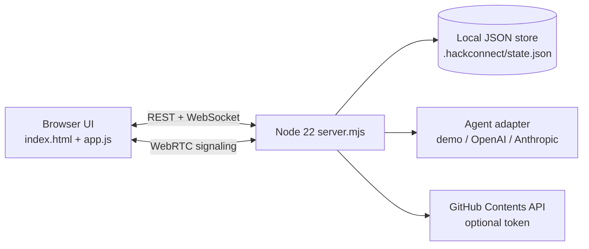

# HackConnect architecture

## Phase 0 architecture

The current runtime is deliberately small and free to run. A single Node process serves the UI, REST API, and WebSocket rooms. The JSON store is suitable for a local demo or trusted single-host use, not for a public multi-tenant deployment.

## Target production decomposition

The master prompt's eventual service boundaries remain:

- `web`: existing UI migrated only if a future audit proves it necessary.
- `api`: authenticated CRUD, policy checks, events, submissions, and quotas.
- `collab`: Hocuspocus/Yjs persistence and awareness.
- `runner`: isolated sandbox and preview proxy; never run untrusted commands in the API process.
- `bridge`: opt-in local folder watcher and outbound tunnel client.
- PostgreSQL for durable relational data, Redis for presence/queues, and S3-compatible storage for snapshots/artifacts.
- LiveKit for production media; browser WebRTC remains the no-cost local fallback.

## Free-first policy

The default path has no paid dependency and no secret requirement. The demo coding agent is deterministic and local. OpenAI, Anthropic, GitHub, LiveKit, email, object storage, and hosted databases are optional adapters, enabled only through environment variables. Credentials are never bundled in frontend code or logged.

## Current architecture (v1)
Single Node process (`lib/app.mjs`): REST + two WebSocket endpoints (`/ws` JSON events, `/collab` binary Yjs) + `/mcp` JSON-RPC. All authorization goes through `lib/policy.mjs`. Yjs documents live in `lib/collab.mjs` and are persisted into the same JSON state as plain files plus an append-only edit history that drives Build Replay and the organizer dashboard. Events/judging (`lib/events.mjs`, `lib/judging.mjs`) read the frozen snapshot taken when judging starts. The Local Bridge (`bridge/`) is just another `/collab` client authenticated by a scoped bearer token. Optional edges: Docker/gVisor runner (`lib/runner.mjs`), `cloudflared` tunnels, an OpenAI-compatible agent endpoint. See the diagram in README.md.
